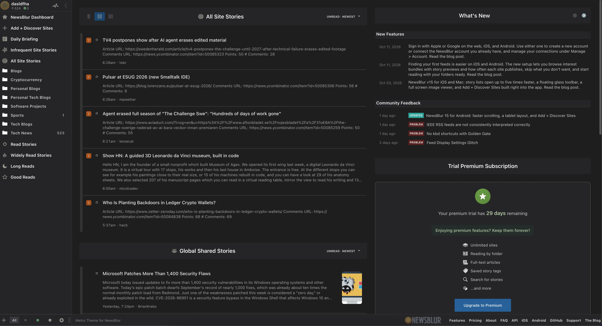
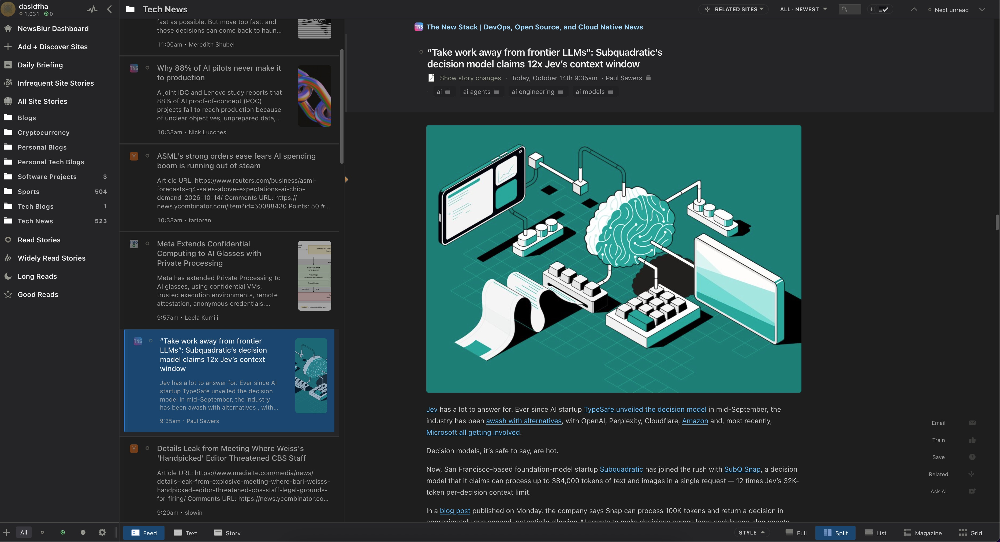

# Metro Theme for NewsBlur

A dark theme for NewsBlur.

## Installation

### Manual

1. Open NewsBlur → Account → Custom CSS/JavaScript.
2. Paste [theme.css](../theme.css) into **Custom CSS** and [theme.js](../theme.js) into **Custom JavaScript**, replacing any existing customization.
3. Save and reload NewsBlur.

## Gallery

